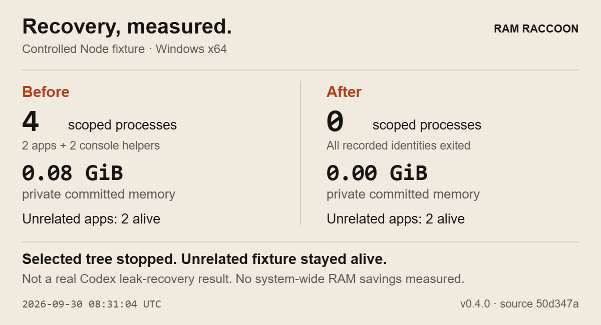

<p align="center">
  
</p>

<p align="center">
  <strong>Find the memory hogs. Keep the useful work.</strong>
</p>

<p align="center">
  <a href="#quick-start">Quick start</a> ·
  <a href="#before-and-after-proof">Before / after</a> ·
  <a href="#platforms-and-devices">Platforms</a> ·
  <a href="./SECURITY.md">Safety</a> ·
  <a href="https://github.com/krutftw/ramraccoon/releases">Release notes</a>
</p>

<p align="center">
  <a href="https://nodejs.org/"></a>
  <a href="./LICENSE"></a>
  <a href="https://github.com/krutftw/ramraccoon/actions/workflows/portable.yml" title="Hosted jobs are blocked by GitHub's account billing lock; see platform status below."></a>
</p>

See system memory pressure, top consumers, and Codex app-server footprints
**before deciding what to stop**. Use the CLI without Codex, or install it as an
agent skill.

**Read-only by default.** No daemon, extra MCP server, or runtime telemetry.
Recovery always requires explicit approval.

## Quick start

Requires **Node.js 20+**; prefer a currently supported LTS release. The GitHub
installs below also need Git on `PATH`, because npm and `skills` fetch the
repository with it. Start with
ordinary user permissions, not administrator/root access.

### As a CLI

```text
npm install --global --allow-git=all github:krutftw/ramraccoon
ramraccoon snapshot
```

npm 12 and later refuse git installs unless `--allow-git` permits them; npm
11.9 and later understand the flag, and older versions warn about an unknown
flag and install normally. Not sure your
environment exposes the required counters? Run `ramraccoon doctor`.

### As a Codex skill

```text
npx skills add krutftw/ramraccoon -a codex -s ramraccoon -g -y
```

The `skills` installer itself requires Node.js 22.20 or newer. On older Node,
copy `skills/ramraccoon` from this repository into your agent's skills folder
(`~/.agents/skills/ramraccoon` is where the installer puts it). Then ask:

```text
Use $ramraccoon to check memory pressure.
Show the largest consumers. Do not stop anything.
```

Installation uses the network; the collector itself does not. Commands work in
PowerShell, Command Prompt, and POSIX shells.

<details>
<summary>One-off run or source checkout</summary>

Without a global CLI install:

```text
npx --yes --allow-git=all --package=github:krutftw/ramraccoon ramraccoon snapshot
```

From this repository:

```text
node skills/ramraccoon/scripts/ramraccoon.mjs snapshot
```

Add `--json` for structured output or `--output <file.json>` to save a snapshot.

</details>

## What a check looks like

An excerpt from an actual Windows run. Your readings will differ.

```text
RAM Raccoon: ELEVATED
Platform: win32/x64
Available RAM: 4.05 GiB (OS available memory)
Commit: 71.24/95.92 GiB (74.3%); available 24.68 GiB
Pressure: host ELEVATED; Codex app-server HEALTHY
Codex app-server trees: 2 processes / 0.06 GiB private bytes
```

**System pressure is not automatically a Codex problem.** The full report also
shows top consumers and Windows service names when readable. Private committed
memory and resident RAM are labelled separately—not added together.

- **Find the pressure:** available RAM, Windows commit headroom, Linux cgroup
  limits, and OS-specific signals.
- **Find the consumers:** system-wide processes and separately measured Codex
  app-server trees. No detected app-server does not mean all Codex CLIs are closed.
- **Keep the evidence:** before/after values, signed deltas, and explicit unknowns.
  A large reading is not proof of a leak; a decrease alone does not prove its cause.

<details>
<summary>How to interpret the memory numbers</summary>

| Reading | What it means |
|---|---|
| Physical available memory | OS availability on Windows/Linux; a labelled free + inactive + speculative estimate on macOS |
| Windows private bytes | Private committed memory, **not** resident RAM; working set is shown separately |
| Linux commit accounting | Not a hard exhaustion threshold in overcommit modes 0/1; enforced pressure only in mode 2 |
| Linux cgroup memory | Readable v1/v2 and visible ancestor constraints, excluding inactive file cache the kernel can reclaim; a container can be under pressure while its host has free RAM |
| macOS/Linux tree memory | Summed RSS, which can double-count shared pages |
| Linux process names | The kernel's name: at most 15 characters, and programs can change it (Node.js reports `MainThread` from 23.8 and `node-MainThread` from 25.5) |
| Missing or restricted data | Warnings and `null`, never invented zero usage or successful recovery |

Top consumers are ranked by Windows private bytes or macOS/Linux RSS. Several
Windows services can share a PID; the process's memory cannot be attributed
independently to each listed service. Thresholds trigger investigation, not
permission to terminate anything.

</details>

## Platforms and devices

**Verification status:** Windows x64, and Linux x64 under WSL2, are verified locally; native Linux hardware, macOS and ARM64 are not.
Native cross-platform CI is currently [blocked by GitHub's account billing lock](./docs/VALIDATION.md#current-external-blocker),
not a failing code test. Configured jobs are not presented as passing jobs.

| Environment | Current status |
|---|---|
| Windows x64 | Live diagnostics, controlled recovery, and public installation verified |
| Linux x64 (WSL2: Ubuntu 22.04 and Alpine) | Regression tests, live diagnostics, and controlled recovery verified; hosted CI pending |
| macOS Intel / Apple Silicon | Collector implemented; parser tests passed; native CI pending |
| Native Linux x64 (not WSL), Linux ARM64, Windows ARM64 | Collectors implemented; native CI pending |
| WSL and Linux containers | Guest/namespace scope and readable limits only; WSL2 verified live, and a cgroup-v2 memory limit verified inside WSL2 |
| Agent sandboxes | Codex's Linux sandbox and other bubblewrap sandboxes hide processes outside them; detected and reported as incomplete, so compare leaves Codex changes unknown and recovery is refused. Codex's Windows sandbox is not detected directly but shows as unavailable or incomplete. Run checks outside the sandbox |
| Native Android, iOS/iPadOS, browsers, BSD | No supported native system collector |

Support follows the OS running Node, not the device label. Linux boards and
ChromeOS Linux environments need the required OS interfaces. A mobile remote
client measures its remote host—not the phone. `doctor` checks capability;
it does not certify a platform. See the [full support and verification record](./docs/VALIDATION.md).

## Save and compare

```text
ramraccoon snapshot --json --output before.json
ramraccoon snapshot --json --output after.json
ramraccoon compare --before before.json --after after.json --json
```

Take the second snapshot **after** the action being measured, on the same host
and with the same selection scope. `--app-server-pid` scopes the Codex tree,
not host counters or top consumers. Select the new PID after a scoped restart.
Missing readings, incomplete scans, and incompatible metrics or scopes do not
become claimed savings. Snapshot files do not authenticate their source host.

## Recovery: separate and destructive

**A memory warning is not permission to kill a process.** Ordinary audits are
read-only. Agent housekeeping keeps useful work and uses only lifecycle APIs
actually available in the host; interrupting an agent is not proof that its
MCP processes exited.

Runtime recovery requires a saved resume checkpoint, an exact top-level Codex
app-server target, and explicit approval to disconnect it. It is not a generic
process cleaner and does not target standalone Codex CLIs.

<details>
<summary>Approved recovery workflow and command</summary>

Save the objective, completed work, remaining work, workspace state, required
external commands/services, and first resume instruction outside volatile
runtime state. Show the target and obtain explicit approval. The CLI cannot
judge whether your checkpoint is sufficient. When the check runs inside Codex
and can see the hosting app-server, `AppServers[].ContainsCurrentProcess` marks
it; inside a sandbox or after an incomplete scan, identify the target with the
user. Recovery disconnects every task open in that app-server, not only one.

Only then, substituting the verified PID, a private evidence directory outside
the repository, and the optional thread ID:

```text
ramraccoon recover --app-server-pid <PID> --output-dir <EVIDENCE_DIR> --thread-id <THREAD_ID> --yes
```

The angle-bracket values are placeholders, not literal shell arguments.
Without `--output-dir`, evidence goes to `.ramraccoon` in the current directory.
Recovery records a full before snapshot, waits 15 seconds, re-checks PID and
start identity, and stops the selected tree. Runtime-owned terminals, MCP
servers, and services may stop. Persisted task transcripts are not edited.
Process enumeration and termination are not an atomic transaction.

The worker's `*-recovery.json` and lightweight `*-after.json` are termination
evidence, **not full post-resume host memory measurements**. Reopen the task or
use `codex resume <THREAD_ID>`, take a normal scoped snapshot, and compare with
`*-before.json`. Protected survivors or missing readings are not reclaimed RAM.
A process that left the tree during the delay, refused a signal, or was started
by the tree during termination was not stopped and makes the result `partial`.
A `partial` or `failed` result never authorizes broadening the target.

</details>

Read the [safety and privacy model](./SECURITY.md) before using recovery.

## Before-and-after proof

These images visualize a recorded **controlled Windows test**, not screenshots
of a real Codex leak recovery.

<picture>
  <source media="(max-width: 900px)" srcset="./assets/recovery-proof-mobile.png">
  
</picture>

The selected tree contained **two test applications and two Windows console
helpers**. RAM Raccoon targeted only the applications; the helpers exited with
them. Both unrelated fixture applications were alive before test teardown.

The 0.08 GiB is **selected-tree private committed memory**, not total resident
RAM freed. The after value is zero because every recorded target identity
exited; it is not a full post-resume host-memory sample.

[Recorded JSON](./evidence/windows-v0.4.0-recovery-proof.json) ·
[Capture method and limits](./docs/VALIDATION.md#recorded-recovery-images) ·
[Full-size image](./assets/recovery-proof.png)

## Built on evidence

**57 regression tests passed on Windows x64, and 56 (plus one Windows-only
skip) on Linux x64 under WSL2 (Ubuntu and Alpine).** Live read-only diagnostics
and controlled fixture recovery passed on all three: the selected tree
stopped, an unrelated fixture survived, and a process that left the tree was
reported `partial` instead of reclaimed. No real Codex runtime was terminated
for these checks. Native Linux hardware, macOS and ARM64 results remain pending.
[See the evidence and limitations](./docs/VALIDATION.md).

```text
npm test
npm run test:live
npm run test:recovery
```

The live checks own their temporary targets. Never substitute a user's live
Codex PID. See [CONTRIBUTING.md](./CONTRIBUTING.md) for platform reports and development.

RAM Raccoon grew out of the upstream [Codex lifecycle issue](https://github.com/openai/codex/issues/25015).
It is a diagnostic and recovery layer—not an upstream fix or a universal RAM
cleaner. Memory interpretation follows the [Linux overcommit](https://docs.kernel.org/mm/overcommit-accounting.html)
and [cgroup documentation](https://www.kernel.org/doc/html/latest/admin-guide/cgroup-v2.html).

---

[Report a bug](https://github.com/krutftw/ramraccoon/issues/new?template=bug_report.yml) ·
[Suggest a feature](https://github.com/krutftw/ramraccoon/issues/new?template=feature_request.yml) ·
[Contribute](./CONTRIBUTING.md) · [Security](./SECURITY.md) · [MIT license](./LICENSE)

Review reports before posting. Keep command lines, credentials, private paths,
thread contents, and task checkpoints out of public issues.
